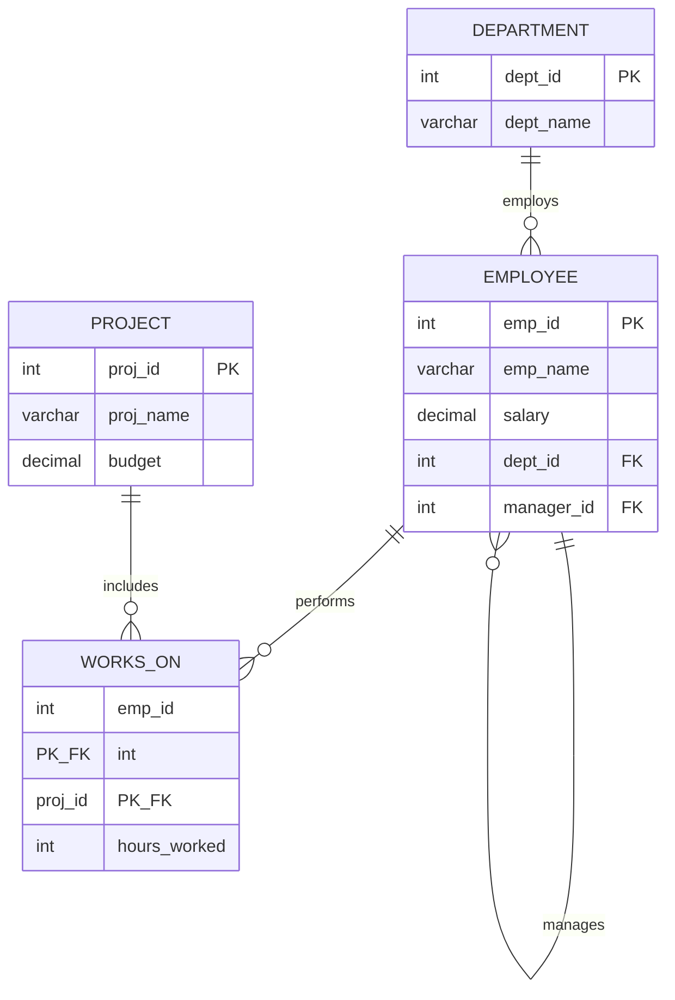

# Database Management Systems (DBMS) Laboratory

<p align="center">
  
  
  
  
</p>

---

## 🎓 Academic Profile & Course Information

| Field | Details |
| :--- | :--- |
| **Student Name** | **Shiva Ganesh Varikuppala** |
| **Course Title** | Database Management Systems Laboratory |
| **Academic Program** | B.Tech — Computer Science & Engineering |
| **Academic Term** | Semester 03 |
| **Primary RDBMS** | MySQL Server 8.0+ / MySQL Workbench |
| **Repository URL** | [github.com/Shiva-Ganesh-Varikuppala/DBMS](https://github.com/Shiva-Ganesh-Varikuppala/DBMS) |

---

## 📌 Course Abstract & Overview

This laboratory repository documents a structured, hands-on progression through fundamental and advanced database engineering principles. Experiments follow standard university curriculum standards, bridging theoretical database design with industry-standard relational query construction and performance tuning.

### Key Competencies Developed
- **Conceptual Modeling**: Entity-Relationship (ER) diagrams, cardinality constraints, weak entities, and specialization/generalization hierarchies.
- **Relational Schema Design**: Mapping ER entities to relational schemas with candidate keys, foreign key constraints (`ON DELETE CASCADE`, `SET NULL`), and domain integrity.
- **DML & Advanced Querying**: Aggregate analytics (`GROUP BY`, `HAVING`), conditional projection (`CASE ... END`), and multi-table operations (Inner, Left, Self, and 3-Way joins).
- **Procedural SQL & Optimization**: Updatable database views, Recursive Common Table Expressions (CTEs), execution plan evaluation (`EXPLAIN`), and PL/SQL procedures/triggers.
- **Data Integrity & Normalization**: Stepwise normalization from UNF through BCNF, ACID compliance, and concurrency control.

---

## 📂 Repository Organization

```text
DBMS/
├── README.md                     
├── Lab 1/                        
│   ├── Practical 1.pdf           
│   └── Readme.md                 
├── Lab 2/                        
│   ├── Practical 2.pdf           
│   └── Readme.md                 
├── Lab 3/                        
│   ├── Experiment 3.sql          
│   ├── Outputs/                  
│   │   └── outputs.m
│   └── Readme.md                 
├── Lab 4/                        
│   ├── Experiment 4.sql          
│   ├── Output.md                 
│   └── Readme.md                 
├── Lab 5/                        
│   ├── Experiment 5.sql          
│   ├── Output.md                 
│   └── Readme.md                 
├── Lab 6/                        
│   ├── Experiment 5.sql          
│   ├── Output.md                 
│   └── Readme.md                 
├── Lab 7/                        
│   ├── Experiment 5.sql          
│   ├── Output.md                 
│   └── Readme.m
├── Lab 8/                        
│   ├── Experiment 5.sql          
│   ├── Output.md                 
│   └── Readme.m
├── Lab 9/                        
│   ├── Experiment 5.sql          
│   ├── Output.md                 
│   └── Readme.m
└── Lab 10/                       
    ├── Experiment 5.sql          
    ├── Output.md                 
    └── Readme.m
```

---

## 🧪 Experiments Index & Lab Matrix

| Lab # | Experiment Title | Core Topics & SQL Features | Lab Guide | Source Code / Artifacts | Status |
| :---: | :--- | :--- | :---: | :---: | :---: |
| **01** | **Entity-Relationship Modeling** | Weak entities, composite/multi-valued attributes, generalization, cardinality | [Documentation](./Lab%201/Readme.md) | [Practical 1.pdf](./Lab%201/Practical%201.pdf) | ✅ Verified |
| **02** | **Relational Schema & DDL Mapping** | DDL `CREATE TABLE`, Primary/Foreign keys, referential integrity | [Documentation](./Lab%202/Readme.md) | [Practical 2.pdf](./Lab%202/Practical%202.pdf) | ✅ Verified |
| **03** | **Data Manipulation & Aggregation** | 30+ records dataset, `GROUP BY`, `HAVING`, `CASE` conditional evaluation | [Documentation](./Lab%203/Readme.md) | [Experiment 3.sql](./Lab%203/Experiment%203.sql) | ✅ Verified |
| **04** | **Complex Joins & Subqueries** | Self joins, 3-way joins, correlated subqueries, set operations, `EXPLAIN` | [Documentation](./Lab%204/Readme.md) | [Experiment 4.sql](./Lab%204/Experiment%204.sql) | ✅ Verified |
| **05** | **Views & Recursive CTEs** | Complex updatable views, self-referencing hierarchy, `WITH RECURSIVE` | [Documentation](./Lab%205/Readme.md) | [Experiment 5.sql](./Lab%205/Experiment%205.sql) | ✅ Verified |
| **06** | **PL/SQL Procedures & Triggers** | Stored procedures with exception handling, `BEFORE/AFTER` audit triggers | [Documentation](./Lab%206/Readme.md) | [Experiment 6.sql](./Lab%206/Experiment%206.sql) | ✅ Verified |
| **07** | **Schema Normalization** | Functional dependencies, 1NF, 2NF, 3NF, BCNF lossless verification | [Documentation](./Lab%207/Readme.md) | [Experiment 7.sql](./Lab%207/Experiment%207.sql) | ✅ Verified |
| **08** | **Transactions & Concurrency** | ACID compliance, `SAVEPOINT`, dirty/non-repeatable read simulation | [Documentation](./Lab%208/Readme.md) | [Experiment 8.sql](./Lab%208/Experiment%208.sql) | ✅ Verified |
| **09** | **Indexing & Query Performance** | 5,000+ rows dataset, B-Tree indexes, cardinality, `EXPLAIN ANALYZE` | [Documentation](./Lab%209/Readme.md) | [Experiment 9.sql](./Lab%209/Experiment%209.sql) | ✅ Verified |
| **10** | **Query Profiling & Optimization** | Table scan elimination, query refactoring, index hinting | [Documentation](./Lab%2010/Readme.md) | [Experiment 10.sql](./Lab%2010/Experiment%2010.sql) | ✅ Verified |

---

## 🗄️ Relational Schema Benchmark (`LabPracticalDB`)

The core hands-on experiments (Labs 3–5) are implemented on the normalized enterprise schema **`LabPracticalDB`**:



---

## 💻 Execution & Verification Guide

### 1. Prerequisites
- **RDBMS**: MySQL Server 8.0 or higher
- **Client**: MySQL Shell / Command-Line Client or MySQL Workbench 8.0+

### 2. Local Setup
```bash
# Clone the repository
git clone https://github.com/Shiva-Ganesh-Varikuppala/DBMS.git

# Enter the repository directory
cd DBMS
```

### 3. Executing a Lab Script
To run an experiment directly via the MySQL CLI:

Examples: 
```bash
# Run Lab 3 (Basic SQL & Aggregation)
mysql -u root -p < "Lab 3/Experiment 3.sql"

# Run Lab 4 (Joins & Subqueries)
mysql -u root -p < "Lab 4/Experiment 4.sql"

# Run Lab 5 (Views & CTEs)
mysql -u root -p < "Lab 5/Experiment 5.sql"
```

Alternatively, open any `.sql` file in **MySQL Workbench** and execute with `Ctrl+Shift+Enter` (Windows/Linux) or `Cmd+Shift+Enter` (macOS).

---

## 📑 Academic Declaration

> **Certification of Original Work:**  
> I hereby declare that the SQL scripts, relational schemas, ER diagrams, and documentation in this repository represent my practical work for the Database Management Systems Laboratory course. All experiments adhere to institutional academic integrity standards and best database design practices.
>
> — **Shiva Ganesh Varikuppala**  
> *Department of Computer Science & Engineering*

---

<p align="center">
  <sub>Maintained for academic coursework, practical assessment, and reference.</sub>
</p>
